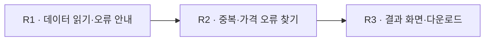

# 전체 진행

*화면 검토용 가상 예시 · 실제 개발·검증 결과 아님*

**현재:** 문제·계획 이해 예시 · 실제 구현 전

## 목표와 범위

| 항목 | 내용 |
|---|---|
| 만들 것 | 주문 오류를 점검하는 웹 프로그램 |
| 필수조건 | 데이터 검증 · 중복·가격 검사 · 오류 이유 표시 |
| 제출물 | 실행 가능한 서비스 · 결과 CSV · 실행 안내 |

## 전체 진행표

<!-- happyhouse:plan:start -->

| 라운드 | 만들 기능 | 난이도·배정 | 목표 잔여 | 진행 | 검증 |
|---|---|---|---|---|---|
| R1 | 데이터 읽기·오류 안내 | 보통·40분 | 02:00:00 | 계획 중 | 미실행 |
| R2 | 중복·가격 오류 찾기 | 높음·45분 | 01:15:00 | 계획 중 | 미실행 |
| R3 | 결과 화면·다운로드 | 보통·35분 | 00:40:00 | 계획 중 | 미실행 |

<!-- happyhouse:plan:end -->

## 완료할 기능

<!-- happyhouse:features:start -->

**R1 · 데이터 읽기·오류 안내**

- [ ] 정상 파일의 내용을 읽는다
- [ ] 빠진 필수 열의 이름을 보여준다
- [ ] 잘못된 데이터를 적용하지 않는다

**R2 · 중복·가격 오류 찾기**

- [ ] 중복 주문을 찾는다
- [ ] 상품 가격과 다른 주문을 찾는다

**R3 · 결과 화면·다운로드**

- [ ] 오류 주문과 이유를 보여준다
- [ ] 화면과 같은 결과를 CSV로 받는다

<!-- happyhouse:features:end -->

**예산:** 이해 20분 + 라운드 120분 + 마무리 40분 = 180분

## 위험

- **R1:** 열 누락 안내와 기존 데이터 유지 여부 확인 필요.
- **R2:** 주문번호의 중복 기준 확인 필요.
