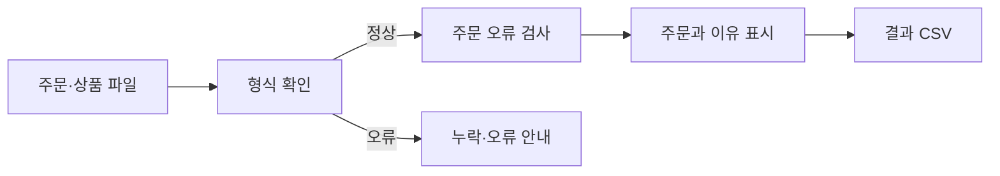

# 문제 이해

*가상 과제 · 실제 시험 원문이나 데이터가 아님*

## 한눈에

- **만들 것:** 주문 오류 점검 웹 프로그램을 만든다.
- **사용할 자료:** 주문 CSV와 상품 CSV를 읽는다.
- **해결할 것:** 중복 주문과 가격 오류를 찾는다.
- **보여줄 것:** 문제가 있는 주문과 이유를 보여준다.

**필수조건:** 오류 데이터 적용 차단 · 기존 데이터 유지 · 결과 CSV 제공

**먼저 확인할 것:** 동일 주문번호가 여러 상품 행에 사용될 수 있는가?

## 전체 흐름

## 해결할 문제

| 필요한 동작·결과 | 완료조건 | 원문 근거 |
|---|---|---|
| 파일 형식 확인 | 누락 열을 알리고 적용을 막는다 | 가상 과제 조건 |
| 중복·가격 확인 | 해당 주문과 이유를 표시한다 | 가상 과제 조건 |
| 결과 저장 | 화면과 같은 CSV를 제공한다 | 가상 과제 조건 |

## 자료와 데이터

| 파일·위치 | 구성·중요 속성 | 역할·연결 | 확인 범위 |
|---|---|---|---|
| 주문 CSV — 가상 | 주문번호·상품번호·가격 | 검사 대상 | 실제 파일 미제공 |
| 상품 CSV — 가상 | 상품번호·기준 가격 | 상품번호로 연결 | 실제 파일 미제공 |

## 예시

- 입력: 기준 가격 1,000원, 주문 가격 1,200원.
- 기대: 해당 주문에 ‘가격 불일치’를 표시한다.
- 근거: 설명용 가상 규칙. 실제 과제에서는 원문 대조 필요.

## 질문과 답변

| 확인할 내용 | 왜 필요한가 | 답변·근거 |
|---|---|---|
| 주문번호가 같으면 모두 중복인가 | 검사 결과가 달라진다 | 미확인 |

## 중요한 정정

없음
